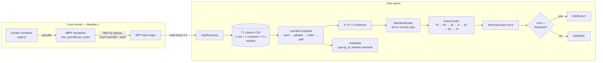

# Syscall Anomaly Detection for Docker Containers

Detects suspicious behaviour inside a running Docker container by watching the
system calls it makes. An eBPF program counts the container's syscalls and
syscall pairs inside the kernel. Every second, the tracer writes one row
covering the last 2 seconds. An autoencoder trained only on normal traffic
flags any window that looks unlike normal behaviour.

No attack signatures or labelled attack data are needed to train it. The model
learns what normal looks like, and anything it can't reconstruct well is
treated as an anomaly.

## Architecture



The system has three stages:

1. **Collection (Member 1, `ebpf/`).** An eBPF program attached to the
   `raw_syscalls:sys_enter` tracepoint watches one container, picked out by
   its cgroup ID. For each syscall it increments a per-syscall counter and a
   counter for the pair (previous syscall, this syscall) in the same thread.
   Counting happens in the kernel, so only the counter tables cross into user
   space each second, not every syscall event. The tracer writes one CSV row
   per second, covering the last 2 seconds.
2. **Data preparation (Member 2, `member2/`).** Loads the CSV and checks it
   against the agreed contract. It then puts columns in a fixed order and
   separates the 3 metadata columns from the 74 model features. The output is
   a `float64` matrix `X` plus the matching metadata rows, which tie each
   prediction back to a container and a time window.
3. **Detection (`person3_ml/`).** Scales the features and passes them through
   the autoencoder. The mean squared reconstruction error is compared against
   a threshold learned from normal traffic only.

### Why these choices

- **In-kernel counting.** Sending every syscall event to user space is
  expensive for a busy container. Counting in BPF maps keeps the cost to a few
  map updates per syscall.
- **Autoencoder, not a classifier.** Real attack data is scarce, and new
  attacks don't match old ones. An autoencoder needs only normal traffic to
  train, and it flags anything it hasn't seen before.
- **Sliding 2-second windows, one per second.** An attack that crosses a
  window boundary still lands whole in at least one window, and alerts still
  come every second. Neighbouring rows overlap, so training uses a time-based
  split rather than a random one.

## Feature vector

Each CSV row has 77 columns: 3 metadata columns and 74 features. The column
list lives in [`member2/schema.py`](member2/schema.py), and the tracer writes
its header from the same list.

| Columns | Count | Meaning | In current data |
|---|---|---|---|
| `cgroup_id`, `window_start_ns`, `window_end_ns` | 3 | Which container and which window (Unix-epoch ns). Never fed to the model. | Real |
| `syscall_01_count` … `syscall_20_count` | 20 | Calls to each of 20 syscall families in the window | Real |
| `pair_01_count` … `pair_50_count` | 50 | Counts of 50 selected consecutive syscall pairs (bigrams), per thread | Real |
| `stat_01`, `stat_02` | 2 | Mean and std of time between syscalls (ns) | Always 0: not implemented yet |
| `stat_03` | 1 | Syscalls that returned an error | Always 0: not implemented yet |
| `stat_04` | 1 | Distinct syscall families seen in the window (0–20) | Real |

71 of the 74 features are populated.

The 20 syscalls fall into two groups:

- **Normal-behaviour syscalls** give the model a baseline: `read`, `write`,
  `recvfrom`, `openat`, `close`, `mmap`, `munmap`, `epoll_wait`, `accept4`,
  `sendfile`.
- **Security-relevant syscalls** stay near zero normally and spike under
  attack: `execve`, `clone`, `connect`, `socket`, `setns`, `unshare`,
  `ptrace`, `fchmodat`, `fchownat`, `kill`.

See [`docs/VOCAB.md`](docs/VOCAB.md) for the full column-by-column definitions,
including which 50 pairs are counted and how they were chosen.

## Repository layout

```
ebpf/              eBPF tracer, syscall vocabulary, pair selection (Member 1)
workload/          normal nginx traffic generator and simulated attacks
member2/           CSV contract, validation, feature matrix, evaluation labels (Member 2)
person3_ml/        autoencoder, training, detection, evaluation, baselines, plots
  models/          trained model, fitted scaler, threshold (current)
  results/         metrics, PR/ROC curves, error plots (current)
  models_unigram/  earlier model, trained before bigrams and sliding windows
  results_unigram/ results of the earlier model
demo/              live watcher: scores each new window and prints NORMAL / ALERT
bench/             per-syscall cost microbenchmark and its results
data/              normal.csv, eval.csv, attack_log.csv, bench.jsonl, *_unigram.csv
bench.py           HTTP throughput/latency benchmark
analyze.py         per-attack detection delay and unshare visibility on eval.csv
results.md         collection-overhead measurements
STATUS.md          per-member status and open items
tests/             test suite with real-data sample fixtures
docs/              contract, vocabulary, handoff and architecture notes
```

## Running it

### Requirements

- **Capture (`ebpf/`, `workload/`, `bench/`):** Linux x86_64 with cgroup v2,
  Docker, root access, and [BCC](https://github.com/iovisor/bcc)
  (`python3-bpfcc`). The syscall numbers in `ebpf/vocab.py` are
  x86_64-specific.
- **Pipeline and model:** Python 3.9+ on any OS. `requirements-ml.txt` pins the
  versions the committed model was trained with; a different scikit-learn
  version prints a warning when loading the scaler.

```bash
pip install -r requirements-ml.txt
```

### 1. Capture normal traffic (Linux only)

```bash
docker run -d --name demo nginx
sudo python3 ebpf/tracer.py demo data/normal.csv      # Ctrl+C to stop
python3 workload/normal_traffic.py demo 600           # in a second terminal
```

### 2. Train the autoencoder

```bash
python3 -m person3_ml.train data/normal.csv
python3 -m person3_ml.plot_results
```

Training holds back the most recent 20% of windows for validation, and drops
training windows that overlap them. The scaler, model and threshold
(mean + 3σ of validation error) are fitted on normal data only and saved to
`person3_ml/models/`. Use `--models-dir` and `--results-dir` to train
somewhere else without overwriting the committed model.

### 3. Detect anomalies in a capture

```bash
python3 -m person3_ml.detect data/normal.csv
```

This prints the reconstruction error for every window and labels each one
`NORMAL` or `ANOMALY`.

### 4. Evaluate against simulated attacks

Capture with the tracer running while `workload/normal_traffic.py` and
`workload/attack.sh` run together. `attack.sh` writes each attack's start and
end time to `data/attack_log.csv`. Then run:

```bash
python3 -m person3_ml.evaluate data/eval.csv data/attack_log.csv
python3 -m person3_ml.baselines data/normal.csv data/eval.csv data/attack_log.csv
python3 -m person3_ml.plot_timeline data/eval.csv data/attack_log.csv
python3 analyze.py
```

A window is labelled as an attack if it overlaps any attack interval. These
report:
- precision, recall, F1 and false-positive rate at each threshold
- precision-recall and ROC curves
- windows flagged per attack
- reconstruction error on attack vs. normal windows
- One-Class SVM and Isolation Forest baselines on the same features
- error over time
- detection delay per attack

Set `SYSCALL_MODELS_DIR` to evaluate a model in another folder.

The simulated attacks are: reconnaissance, dropping and running a binary,
an outbound connection, a namespace-escape attempt, and a process-spawn storm.

### 5. Live demo (Linux only)

```bash
python3 demo/watch.py data/live.csv                   # start this first
sudo python3 ebpf/tracer.py demo data/live.csv        # second terminal
python3 workload/normal_traffic.py demo 600           # third terminal
bash workload/attack.sh demo                          # trigger attacks
```

### Using the pipeline from code

```python
from member2.pipeline import prepare_aggregated_csv, prepare_window
from person3_ml.detect import score_window, anomaly_threshold

# A whole capture
prepared = prepare_aggregated_csv("data/normal.csv")
prepared.X                 # (585, 74) float64
prepared.metadata_rows     # (cgroup_id, window_start_ns, window_end_ns) per row

# One live window, e.g. a row the tracer just wrote
x = prepare_window(row)    # row: dict of the 77 column names to values
if score_window(x) > anomaly_threshold():
    print("ALERT")
```

### Tests

```bash
python3 -m unittest discover -s tests -v
```

## Results

Trained on `data/normal.csv` (585 windows; 467 training, 117 validation, split
by time). Evaluated on `data/eval.csv`: 189 windows, 15 attack and 174 normal.
Threshold: mean + 3σ of validation error (0.0138).

| Detector | TP | FP | TN | FN | Precision | Recall | F1 | FPR | Attacks detected |
|---|---|---|---|---|---|---|---|---|---|
| Autoencoder | 10 | 1 | 173 | 5 | 0.909 | 0.667 | 0.769 | 0.006 | 5/5 |
| One-Class SVM | 10 | 0 | 174 | 5 | 1.000 | 0.667 | 0.800 | 0.000 | 5/5 |
| Isolation Forest | 0 | 0 | 174 | 15 | 0.000 | 0.000 | 0.000 | 0.000 | 0/5 |

- **Every window containing attack syscalls was flagged.** Their errors are
  over 1,000× the highest normal error. The 5 missed windows are an outbound
  connection that hangs and looks idle.
- **Curves (autoencoder):** average precision 0.708, ROC AUC 0.797.
- **Detection delay:** mean about 0.79 s, max 1.01 s.
- **Scoring time:** about 0.14 ms per window.
- **Collection cost:** the in-kernel tracer adds 405 ns per syscall (1.64× on
  a `getpid` loop), against 896× for exporting every event to user space.
  Exporting every event also cut nginx throughput by 72.8%. See
  [results.md](results.md).

Results from before bigrams and sliding windows are kept in
`person3_ml/results_unigram/` and are superseded.

## Limitations

- **Blocked syscalls are invisible.** Docker's default seccomp profile
  rejects `unshare` before the tracepoint fires, so it never appears in the
  data.
- **`clone → execve` can't be seen as a pair.** Pairs are counted per thread,
  and the two calls happen in different processes.
- **Pair selection used attack traffic.** The 50 pairs were chosen from a
  capture that included the simulated attacks. Zeroing the pairs that only
  attacks produce leaves detection unchanged (5/5 attacks, 0 false positives).
- **`docker exec` adds syscalls.** Simulated attacks run through
  `docker exec`, which adds syscalls of its own to every attack's signature.
- **Rows overlap.** Neighbouring windows share a second, so they aren't
  independent samples.
- **Narrow scope.** One container at a time, x86_64 only, nginx only, and the
  evaluation has 15 attack windows.
- **Virtual machine.** Measurements were taken in a VirtualBox VM, where
  throughput varies by about ±14% between runs.

See [STATUS.md](STATUS.md) for open items.

## Team

| Member | Area | Code |
|---|---|---|
| Naman | eBPF collection, bigrams, workloads, vocabulary, overhead benchmarks | `ebpf/`, `workload/`, `bench/`, `demo/` |
| Krishita | CSV contract, data pipeline, labels, retraining, evaluation, baselines | `member2/`, `tests/`, `person3_ml/` |
| Abhiram | Autoencoder design and original training pipeline | `person3_ml/` |

## Further documentation

- [`docs/VOCAB.md`](docs/VOCAB.md): what every feature column means, and how
  the pairs were chosen
- [`docs/naman_krishita_csv_contract.md`](docs/naman_krishita_csv_contract.md):
  the CSV format between collection and preparation
- [`results.md`](results.md): collection-overhead measurements
- [`handoff_krishita_retrain.md`](handoff_krishita_retrain.md): what changed
  with bigrams and sliding windows
- [`docs/member2_abhiram_handoff.md`](docs/member2_abhiram_handoff.md): the
  interface between preparation and the model
- [`docs/review2_intermediate_artifacts.md`](docs/review2_intermediate_artifacts.md):
  Review 2 artifacts
